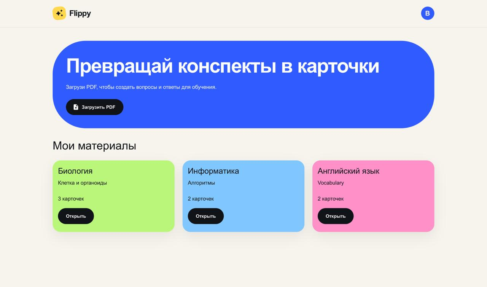
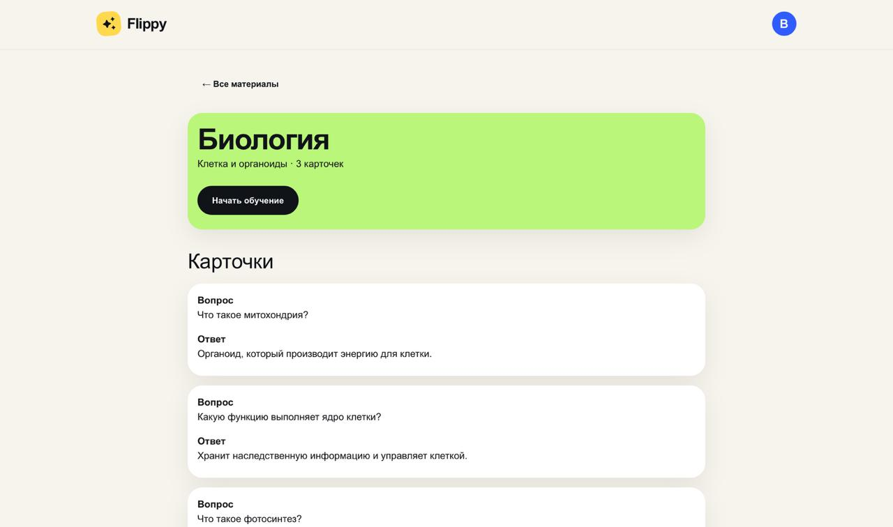
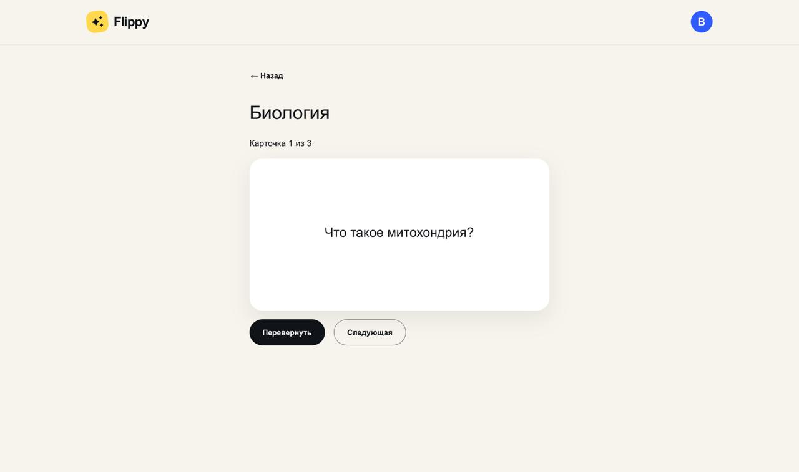

# Flippy

Flippy — учебное веб-приложение для автоматического создания карточек
в формате «вопрос — ответ» из PDF-конспектов.

Проект разрабатывается в рамках курса Fullstack. Каждая лабораторная
работа расширяет возможности приложения.

## Назначение

Flippy помогает студентам готовиться к занятиям и экзаменам.
В готовой версии пользователь сможет загрузить PDF-конспект,
получить учебные карточки и использовать их для повторения материала.

## Планируемые пользовательские сценарии

### Загрузка материала

Пользователь загружает PDF-файл, на основе которого приложение
создаёт материал с набором вопросов и ответов.

### Работа с карточками

Пользователь открывает материал, просматривает вопросы и ответы,
а также может добавлять, редактировать и удалять карточки.

### Обучение

Пользователь запускает режим обучения, переворачивает карточки
для просмотра ответов и переходит к следующим вопросам.

## Текущие возможности

- Просмотр демонстрационных материалов.
- Просмотр вопросов и ответов выбранного материала.
- Режим обучения с переворотом и переключением карточек.
- Выбор PDF-файла через системное окно без отправки и обработки.
- Запуск backend на FastAPI.
- Интерактивная документация API по адресу `/docs`.
- Создание, получение, изменение и удаление материалов через API.
- Создание, получение, изменение и удаление учебных карточек через API.
- Хранение данных в PostgreSQL через SQLAlchemy.
- Валидация запросов и ответов.
- Каскадное удаление карточек при удалении материала.

Frontend использует демонстрационные данные и пока не подключён
к backend. Работа с PostgreSQL доступна через API
Обработка PDF и AI-генерация ещё не реализованы

## Основные экраны

- **Мои материалы** — выбор PDF-файла и список демонстрационных материалов.
- **Карточки материала** — просмотр вопросов и ответов выбранного материала.
- **Режим обучения** — переворот карточки и переход к следующей.

## Маршруты frontend

- `/` — мои материалы
- `/documents/:id` — карточки выбранного материала
- `/documents/:id/study` — режим обучения

`:id` — идентификатор материала, например `biology`

## Технологии

### Frontend

- React;
- TypeScript;
- Vite;
- Material UI;
- React Router.

### Backend

- Python 3.13;
- FastAPI;
- Uvicorn;
- PostgreSQL 17;
- SQLAlchemy;
- psycopg;
- Pydantic;
- pydantic-settings.


### Контроль версий

- Git;
- GitHub.

## Структура проекта

```text
flippy/
|
-- backend/
|   -- app/
|   |   -- routers/
|   |   |   -- __init__.py
|   |   |   -- materials.py
|   |   |   -- cards.py
|   |   |
|   |   -- __init__.py
|   |   -- main.py
|   |   -- config.py
|   |   -- database.py
|   |   -- models.py
|   |   -- schemas.py
|   |   -- crud.py
|   |   -- create_tables.py
|   |
|   -- .env.example
|   -- requirements.txt
|
-- frontend/
|   -- public/
|   |   -- favicon.svg
|   |   -- icons.svg
|   |
|   -- src/
|   |   -- assets/
|   |   |   -- hero.png
|   |   |   -- react.svg
|   |   |   -- vite.svg
|   |   |
|   |   -- components/
|   |   |   -- AppHeader.tsx
|   |   |
|   |   -- data/
|   |   |   -- mockData.ts
|   |   |
|   |   -- pages/
|   |   |   -- MaterialsPage.tsx
|   |   |   -- DocumentPage.tsx
|   |   |   -- StudyPage.tsx
|   |   |
|   |   -- App.tsx
|   |   -- App.css
|   |   -- main.tsx
|   |   -- index.css
|   |   -- theme.ts
|   |
|   -- .gitignore
|   -- .oxlintrc.json
|   -- index.html
|   -- package.json
|   -- package-lock.json
|   -- tsconfig.json
|   -- tsconfig.app.json
|   -- tsconfig.node.json
|   -- vite.config.ts
|   -- README.md
|
-- docs/
|   -- screenshots/
|       -- materials.jpg
|       -- documents.jpg
|       -- study.jpg
|
-- .gitignore
-- README.md
```

## Лабораторная работа №1

Реализован интерфейс приложения и каркас frontend:

- три функционально разных экрана
- клиентская маршрутизация
- общая шапка и тема Material UI
- базовая адаптивность
- демонстрационные материалы и карточки
- режим обучения с переворотом карточек

Реальная отправка и обработка PDF на этом этапе не выполняются


## Лабораторная работа №2

Реализована серверная часть приложения:

- настройки подключения вынесены в переменные окружения
- подготовлен `.env.example` без секретов
- PostgreSQL подключена через SQLAlchemy и драйвер psycopg
- созданы связанные таблицы материалов и карточек
- реализован CRUD обеих сущностей
- добавлены схемы валидации запросов и ответов
- отсутствующие записи обрабатываются статусом 404
- некорректные данные обрабатываются статусом 422
- проверены сохранение данных после перезапуска backend 

Frontend и backend на этом этапе работают отдельно

## Модель данных
В базе используются две связанные таблицы: materials и cards.

### Материалы — materials
Каждая запись описывает один учебный материал.

Поля:
- id — целочисленный первичный ключ, назначается автоматически;
- title — название, до 200 символов;
- subtitle — описание темы, до 300 символов;
- color — цвет, до 7 символов. API проверяет формат #RRGGBB.

### Карточки — cards
Каждая запись содержит один вопрос и ответ.

Поля:
- id — целочисленный первичный ключ, назначается автоматически
- material_id — внешний ключ на materials.id
- question — текст вопроса
- answer — текст ответа

Все поля имеют ограничение NOT NULL

Один материал может содержать несколько карточек
Каждая карточка принадлежит одному материалу

Для material_id создан индекс. Внешний ключ не позволяет добавить
карточку к несуществующему материалу. При удалении материала
связанные карточки удаляются автоматически

## Маршруты API

### Проверка сервера

- GET / — проверить, что сервер работает.

### Материалы

- POST /materials — создать материал
- GET /materials — получить список материалов
- GET /materials/{material_id} — получить один материал
- PUT /materials/{material_id} — изменить материал
- DELETE /materials/{material_id} — удалить материал

### Карточки

- POST /materials/{material_id}/cards — создать карточку материала
- GET /materials/{material_id}/cards — получить карточки материала
- GET /cards/{card_id} — получить одну карточку
- PUT /cards/{card_id} — изменить карточку
- DELETE /cards/{card_id} — удалить карточку

При изменении через PUT нужно передать все редактируемые поля
Перенос карточки в другой материал не реализован

### Статусы ответов

- 200 — данные получены или изменены
- 201 — запись создана
- 204 — запись удалена, тело ответа отсутствует
- 404 — запись не найдена
- 422 — переданы некорректные данные

Запросы можно проверить через документацию по адресу
http://127.0.0.1:8000/docs


## Запуск frontend

Потребуются Node.js и npm.

Из корня репозитория выполните:

```bash
cd frontend
npm install
npm run dev
```

Откройте адрес, который появится в терминале
По умолчанию Vite использует http://localhost:5173/

### Проверка frontend

Из папки `frontend`:

```bash
npm run lint
npm run build
```

- `lint` — проверка кода линтером;
- `build` — проверка TypeScript и создание сборки в папке `dist`.


## Запуск backend
Требуются Python 3.13 и PostgreSQL 17.
Команды активации окружения приведены для macOS и Linux.

### Подготовка PostgreSQL
Пример установки и запуска на macOS через Homebrew:

```bash
brew install postgresql@17
brew services start postgresql@17
```

Откройте консоль PostgreSQL и подключитесь к базе postgres, чтобы создать пользователя и базу для Flippy. 
Если PostgreSQL установлен через Homebrew, выполните:

```bash
/opt/homebrew/opt/postgresql@17/bin/psql -d postgres
```

В консоли psql создайте пользователя:

```sql
CREATE ROLE flippy_user WITH LOGIN;
```

Задайте ему собственный пароль:

```text
\password flippy_user
```

Создайте базу и выйдите:

```sql
CREATE DATABASE flippy OWNER flippy_user;
```

```text
\q
```

### Подготовка Python-окружения

Из корня репозитория:

```bash
cd backend
python3.13 -m venv .venv
source .venv/bin/activate
python -m pip install -r requirements.txt
```

### Настройка подключения

Из папки backend:

```bash
cp .env.example .env
```
Заполните `.env` собственными значениями по примеру `.env.example`
Файл `.env` не добавляется в Git

### Создание таблиц

Из папки backend с активированным окружением:

```bash
python -m app.create_tables
```

Команда создаёт отсутствующие таблицы по моделям SQLAlchemy

### Запуск сервера

Из папки backend с активированным окружением:

```bash
python -m uvicorn app.main:app --reload
```

- Проверочный маршрут: http://127.0.0.1:8000/
- Документация API: http://127.0.0.1:8000/docs

`--reload` включает автоматический перезапуск при изменении кода
и предназначен для разработки.

Для остановки нажмите Ctrl + C


### Повторный запуск

Из корня репозитория:

```bash
cd backend
source .venv/bin/activate
python -m uvicorn app.main:app --reload
```

Повторно создавать окружение не нужно. После изменения
`requirements.txt` необходимо снова установить зависимости.

## Проверка API

Маршрут `GET /` возвращает статус `200 OK` и JSON:

```json
{
  "message": "Flippy API работает"
}
```

Для проверки через документацию:
1. Откройте http://127.0.0.1:8000/docs
2. Раскройте маршрут `GET /`
3. Нажмите `Try it out`
4. Нажмите `Execute`
5. Проверьте код `200` и содержимое `Response body`

Также вручную проверены CRUD материалов и карточек, ответы 404 для отсутствующих записей и 422 для некорректных данных
Проверены сохранение данных после перезапуска backend, удаление отдельной карточки без удаления материала и каскадное удаление
карточек вместе с материалом.

## Скриншоты

### Мои материалы



### Карточки материала



### Режим обучения




## Локальные файлы

В Git не добавляются:

- `node_modules/` — установленные зависимости frontend;
- `dist/` — результат сборки frontend;
- `.venv/` — виртуальное окружение Python;
- `__pycache__/` — кеш Python;
- `.env` — локальные настройки и секреты.

Зависимости frontend описаны в `package.json` и `package-lock.json`,
а зависимости backend — в `requirements.txt`.